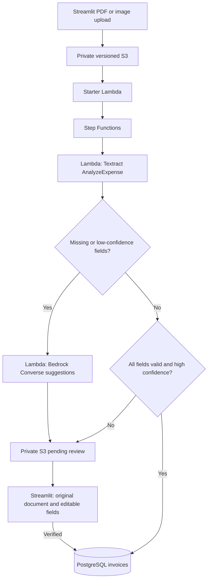

# Paper-to-Digital Invoice Intelligence Platform

Python · PostgreSQL · Lambda · Step Functions · S3 · Textract · Amazon Bedrock · Streamlit · AWS CDK

Project period recorded on the résumé: **July–September 2025**. The Step Functions,
review gate and Bedrock implementation in this revision were added in **October 2026**.
These dates distinguish the original project from subsequent implementation work.

The intelligence workflow extracts invoice fields with Textract, asks Amazon
Bedrock to suggest missing or low-confidence fields, and holds uncertain records
in private S3 for Streamlit review **before inserting an invoice into PostgreSQL**.
High-confidence valid records can be saved automatically. Model suggestions always
require human review. The schema remains invoice number, vendor, date and amount.



## Run and deploy

```sh
python -m venv .venv
source .venv/bin/activate
pip install -r requirements.txt -r requirements-dev.txt
python -m pytest tests/unit/test_intelligence.py tests/unit/test_intelligence_handlers.py -q
cdk synth --app 'python intelligence_app.py'
```

The default CDK entry point deploys `InvoiceIntelligenceStack`, separate from
the existing `app.py` legacy stack. Existing resources and local prescription work are not migrated or deleted.
Use `cdk --app "python app.py"` only when explicitly maintaining the legacy stack.

1. Apply `database/migrations/001_intelligence.sql` to the existing invoice
   database. It adds an idempotency key without dropping tables. The legacy
   `database/schema.sql` is destructive and is only suitable for a new empty DB.
2. Create a Secrets Manager secret with `host`, `port`, `username`, `password`,
   `dbname`. The database must be reachable by Lambda and support TLS. Private
   RDS requires adding VPC/subnet/security-group configuration before deployment;
   this stack does not provision database networking.
3. Select an enabled **in-region Converse-compatible** Bedrock model. Supply its
   exact model ID and foundation-model ARN. Cross-region inference profiles need
   additional destination-model permissions and are not configured by this stack.
4. Review `cdk diff --app 'python intelligence_app.py'`, then deploy with
   `DatabaseSecretArn`, `BedrockModelId`, and `BedrockModelArn` parameters.
5. Configure the Streamlit AWS bucket to the new stack's `InvoiceBucket` output,
   prefix `invoices/`, and its database credentials. Run
   `streamlit run src/web_portal/app.py`. The portal's authenticated
   **Extraction Review** page lists pending candidates and opens the original.
   Its AWS identity needs list/read access to pending records, source-version read
   access and delete permission for completed review markers, plus invoice upload.

Only the persistence Lambda can read the database secret. Bedrock permission is
scoped to the supplied model ARN. S3 is private, versioned and retained on deletion.
Duplicate delivery uses deterministic Step Functions execution names; database
inserts have a unique extraction ID. Reapproving a completed record is a no-op.

## Implementation map

- `intelligence_app.py`, `invoice_pipeline/intelligence_stack.py`: CDK entry and orchestration.
- `src/lambda_functions/intelligence.py`: normalization, confidence gate, model merge, persistence.
- `src/lambda_functions/intelligence_handlers.py`: S3 starter, OCR, fallback, review queue and persistence.
- `src/web_portal/pages/03_Extraction_Review.py`: authenticated review before insert.
- `database/migrations/001_intelligence.sql`: additive invoice migration.
- `docs/VALIDATION.md`: verification and remaining deployment work.
- `docs/LEGACY_INVOICE.md`: previous documentation; its direct S3 → Lambda path
  is not the intelligence workflow. Historical scale/performance claims there
  are not measurements of this implementation.

## Boundaries

The current OCR call is synchronous `AnalyzeExpense`: use supported images or a
single-page PDF containing one invoice. Multi-page asynchronous Textract is not
implemented. Non-ISO OCR dates are sent to manual review. Bedrock sees OCR text,
so it cannot recover information missing from that transcript; reviewers can
inspect the original document. Failed model calls route to review. OCR failures
fail the execution for inspection/retry rather than creating an accepted row.

No AWS deployment, live provider run, throughput, accuracy or cost result is
claimed by the local tests. The inherited secrets-based Streamlit admin login
remains demo authentication. Production operation needs a deployment-specific
access, networking, observability and retention setup.
