# Google sign-in setup

The invoice portal uses Streamlit's OpenID Connect integration on top of OAuth 2.0. Google establishes identity; an explicit email-to-database-user mapping grants access. Every data page rechecks that identity before creating AWS clients or opening a database session. The old shared-password login is removed.

## Owner configuration

1. In [Google Cloud Console](https://console.cloud.google.com/), select your project and open **Google Auth Platform**. Configure Branding and Audience. For an external app in testing, add each intended reviewer as a test user.
2. Create a **Web application** OAuth client under Clients. Register the exact callback URI:
   - Local: `http://localhost:8501/oauth2callback`
   - Hosted: `https://YOUR-INVOICE-APP-HOST/oauth2callback`
   The callback belongs to the Streamlit invoice app, not the portfolio site. Use HTTPS on the hosted app. Register separate development/production clients if possible.
3. Copy `.streamlit/secrets.toml.example` to `.streamlit/secrets.toml` from the repository root, or put its settings in your hosting platform's private Streamlit secrets. Fill `[auth.google]` with the client ID and secret, and set `[auth].redirect_uri` to the registered callback. Generate `[auth].cookie_secret` with `python -c 'import secrets; print(secrets.token_urlsafe(48))'`. Keep the existing database/AWS sections. Do not commit this file or paste its values into chat.
4. In `[access.reviewers]`, replace the example email with each approved, verified Google email. The value is that reviewer's **distinct existing `users.id`** in PostgreSQL, used for invoice ownership/audit attribution. Do not map every reviewer to ID 1. Confirm the email and ID with `SELECT id, email FROM users;` using your database admin tool. If provisioning an OAuth-only user in the existing schema, use a non-password marker such as `OIDC_ONLY_NO_PASSWORD` for `hashed_password`; Google handles sign-in. No database password login is exposed by the portal.
5. Install `pip install -r requirements.txt -r src/web_portal/requirements.txt`, then run `streamlit run src/web_portal/app.py` **from the repository root**. Restart the hosted app after saving its secrets.
6. Test an approved account, an unapproved account, sign-out, and direct navigation to Analytics, Invoice Details and Extraction Review. Confirm approvals/audit records use the mapped account. If Google reports `redirect_uri_mismatch`, compare the complete URI (scheme, hostname, port and path) in both configurations.

Google client setup documentation: [Google OpenID Connect](https://developers.google.com/identity/openid-connect/openid-connect). Framework callback and cookie behavior: [Streamlit authentication](https://docs.streamlit.io/develop/concepts/connections/authentication).

## Access behavior and limitations

- Default sign-in scopes are `openid profile email`; the application requests no Gmail or Drive access and does not expose access tokens.
- An unverified email, wrong issuer, missing subject, expired identity token, unlisted email or invalid user-ID mapping is denied. Missing configuration shows setup guidance and grants no access. A legacy `authenticated=True` flag does not bypass Google identity checks.
- The portal retains its existing admin-capable permissions for every approved reviewer. This is **not** a new multi-tenant or fine-grained role system. Database roles/is_active do not replace the allowlist; remove an email from the configured mapping and reload secrets/restart to revoke app access.
- Streamlit's browser identity cookie may last 30 days. This app also requires the Google token's `exp` to remain valid on each rerun; sign out and sign in again when it expires. Sign-out clears this session's invoice/widget state and Streamlit identity cookie. Other already-open tabs are not centrally terminated; their next rerun still checks expiry and the allowlist. Google itself may remain signed in.
- Streamlit/Authlib handles OAuth state, nonce, token signature and audience validation. The app's authorization tests use trusted-claim fixtures; they do not claim a real Google callback was exercised.
- Live Google sign-in is pending owner client registration, secrets, a hosted callback URL, and end-to-end testing. Existing AWS deployment and data-connection prerequisites still apply.

## Structure

```mermaid
flowchart LR
  Browser[Reviewer] --> Login[Streamlit login page]
  Login --> Google[Google OIDC]
  Google --> Callback[Validated oauth2callback]
  Callback --> Identity[Google issuer, verified email, subject, expiry]
  Identity --> Allowlist[Approved email to distinct user ID]
  Allowlist --> Gate[Per-page authorization guard]
  Gate --> Review[Upload, analytics, invoice details, extraction review]
  Review --> Data[S3 and PostgreSQL]
```

Code: `src/web_portal/authentication.py`, `pages/login.py`, and the guard at the start of each data page. Configuration: `.streamlit/secrets.toml.example`. Tests: `tests/unit/test_portal_auth.py`.
